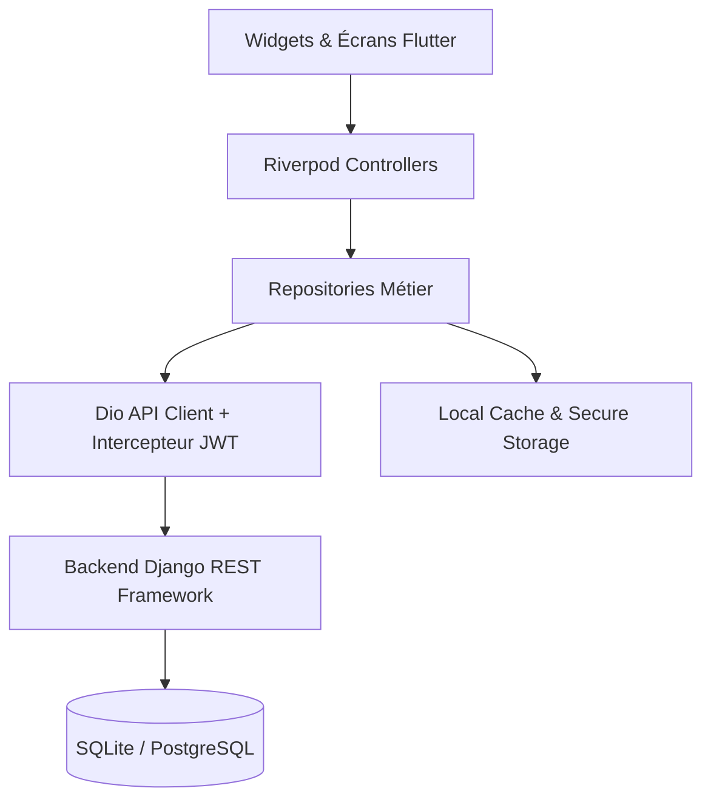

# SMART TECH Mobile — Application Mobile Multiplateforme (Android & iOS)

Application mobile officielle pour la plateforme de gestion commerciale **SMART TECH**, développée avec **Flutter & Dart**, interconnectée avec le backend **Django REST Framework (DRF)** existant.

Ce document fournit le guide complet d'architecture, d'installation, d'exécution, de sécurisation et de déploiement pour Android et iOS.

---

## Table des Matières

1. [Architecture Globale & Choix Technologiques](#1-architecture-globale--choix-technologiques)
2. [Structure du Code Source Flutter](#2-structure-du-code-source-flutter)
3. [Prérequis & Installation](#3-prérequis--installation)
4. [Configuration Réseau & Connectivité Backend](#4-configuration-réseau--connectivité-backend)
5. [Authentification, Sécurité & RBAC](#5-authentification-sécurité--rbac)
6. [Fonctionnalités Implémentées](#6-fonctionnalités-implémentées)
7. [Mode Hors-Ligne & Gestion du Cache](#7-mode-hors-ligne--gestion-du-cache)
8. [Commandes de Lancement & Exécution](#8-commandes-de-lancement--exécution)
9. [Procédure de Build & Déploiement](#9-procédure-de-build--déploiement)
10. [Tests & Validation](#10-tests--validation)
11. [Limitations Techniques & Environnement](#11-limitations-techniques--environnement)
12. [Roadmap & Évolutions Futures](#12-roadmap--évolutions-futures)

---

## 1. Architecture Globale & Choix Technologiques

L'application mobile adopte une architecture **Feature-First** (Domain-Driven Design modulaire) assurant une séparation stricte des responsabilités :

- **Présentation (UI / Controller)** : Widgets Flutter réactifs, StateNotifier Riverpod, `go_router` avec guards d'authentification et navigation shell par rôle.
- **Domaine (Domain)** : Modèles métier immuables avec parsing JSON sécurisé, validation des règles d'affaires locales (marges, alertes, panier POS).
- **Données (Data / Network)** : `Dio` avec intercepteur JWT automatique (`AuthInterceptor`), gestion globale des exceptions (`ErrorHandler`), stockage des secrets dans le trousseau matériel (`flutter_secure_storage`) et cache local hors-ligne (`shared_preferences`).
- **Graphiques & Intelligence IA** : Visualisation dynamique des ventes et indicateurs prédictifs avec `fl_chart`.



---

## 2. Structure du Code Source Flutter

Le projet mobile est entièrement situé dans le sous-dossier `mobile/` :

```text
mobile/
├── android/                             # Configuration native Android
│   ├── app/
│   │   ├── build.gradle.kts             # Configuration Gradle (MinSDK 21, TargetSDK 34)
│   │   └── src/main/AndroidManifest.xml # Permissions (INTERNET, CAMERA, Cleartext)
│   ├── build.gradle.kts
│   └── settings.gradle.kts
├── ios/                                 # Configuration native iOS
│   └── Runner/
│       └── Info.plist                   # Permissions (Caméra, App Transport Security)
├── lib/
│   ├── app/
│   │   └── app.dart                     # MaterialApp.router, thèmes clair/sombre
│   ├── core/                            # Briques transversales
│   │   ├── config/                      # Environment & AppConfig (changement IP à chaud)
│   │   ├── network/                     # Dio, ApiClient, AuthInterceptor, ErrorHandler
│   │   ├── routing/                     # GoRouter avec redirection auth & shell navigation
│   │   ├── storage/                     # SecureStorageService & LocalCacheService
│   │   └── theme/                       # AppColors & AppTheme (Material 3 moderne)
│   ├── features/                        # Modules fonctionnels
│   │   ├── alerts/                      # Alertes ruptures & Notifications système
│   │   ├── auth/                        # Authentification JWT, profil, session
│   │   ├── cash_register/               # Caisse POS, panier tactile, reçu numérique
│   │   ├── customers/                   # Gestion des clients et soldes créditeurs
│   │   ├── dashboard/                   # KPIs exécutifs & graphiques de vente
│   │   ├── inventory/                   # Niveaux de stock, mouvements & ajustements
│   │   ├── products/                    # Catalogue produits, recherche, formulaire
│   │   ├── purchases/                   # Réception approvisionnements & livraisons
│   │   ├── reports/                     # Rapports d'activité & Intelligence IA
│   │   ├── settings/                    # Configuration serveur & profil utilisateur
│   │   └── suppliers/                   # Partenaires fournisseurs & suivi des dettes
│   ├── shared/                          # Widgets réutilisables (Cards, Badges, etc.)
│   └── main.dart                        # Point d'entrée initialisant le stockage et l'app
├── test/                                # Tests unitaires Dart/Flutter
│   ├── auth_test.dart
│   ├── cart_test.dart
│   └── models_test.dart
├── .env.example                         # Gabarit des variables d'environnement
└── pubspec.yaml                         # Dépendances et métadonnées Flutter
```

---

## 3. Prérequis & Installation

### Prérequis
- **Flutter SDK** : Version `>= 3.19.0` (Dart `>= 3.3.0`)
- **Android Studio** (avec Android SDK Platform 34) ou **Xcode** (pour macOS/iOS)
- **Backend SMART TECH** en cours d'exécution sur le port `8000`

### Installation des dépendances Flutter
```bash
cd mobile
flutter pub get
```

---

## 4. Configuration Réseau & Connectivité Backend

Le serveur Django et l'application mobile doivent pouvoir communiquer. Selon votre cible d'exécution, l'adresse IP à configurer varie :

| Cible d'exécution | Adresse Base URL à utiliser |
|---|---|
| **Émulateur Android officiel** | `http://10.0.2.2:8000/api` |
| **Simulateur iOS (Mac)** | `http://127.0.0.1:8000/api` |
| **Émulateur Genymotion** | `http://10.0.3.2:8000/api` |
| **Smartphone Physique (Wi-Fi)** | `http://<IP_LOCALE_PC>:8000/api` (ex: `http://192.168.1.50:8000/api`) |

### Modification à chaud de l'IP du serveur
L'application intègre un écran dédié **Configuration Serveur** accessible :
1. Sur l'écran de connexion via l'icône réseau `Paramètres Réseau`.
2. Dans le menu **Profil & Paramètres** > **Serveur Django API**.
3. Permet de tester instantanément la connectivité (*ping healthcheck*) et d'enregistrer la nouvelle URL sans redémarrer l'application.

### Côté Backend Django
- `ALLOWED_HOSTS` est configuré pour accepter `10.0.2.2`, `10.0.3.2`, `127.0.0.1`, `localhost` et les adresses IP du réseau local.
- Le middleware `SimpleCorsMiddleware` autorise les requêtes multi-origines (CORS) avec gestion des pré-vols `OPTIONS`.

---

## 5. Authentification, Sécurité & RBAC

### Gestion des Jetons JWT
- `POST /api/token/` : Obtention du jeton d'accès (`access`) et de rafraîchissement (`refresh`).
- Les jetons sont stockés de manière chiffrée dans le **Keystore** Android et le **Keychain** iOS via `flutter_secure_storage`.
- Si le jeton d'accès expire (code `401`), le `AuthInterceptor` déclenche un appel silencieux à `POST /api/token/refresh/` et rejoue la requête initiale en toute transparence.

### Matrice des Rôles (RBAC)

| Rôle | Caisse POS | Stock & Ajustement | Achats / Arrivages | Rapports & IA | Gestion Utilisateurs |
|---|:---:|:---:|:---:|:---:|:---:|
| **Admin** | ✅ | ✅ | ✅ | ✅ | ✅ |
| **Manager** | ✅ | ✅ | ✅ | ✅ | ❌ |
| **Magasinier** | ❌ | ✅ | ✅ | ❌ | ❌ |
| **Caissier** | ✅ | ❌ (Lecture seule) | ❌ | ❌ | ❌ |

---

## 6. Fonctionnalités Implémentées

1. **Authentification & Session** :
   - Écran de connexion moderne avec chips de comptes de démonstration pour tester chaque rôle en 1 clic.
   - Restauration automatique de session au démarrage.
2. **Tableau de Bord Exécutif** :
   - Indicateurs en temps réel (chiffre d'affaires, valeur du stock, alertes, ruptures).
   - Graphique interactif de la tendance des ventes sur 14 jours (`fl_chart`).
   - Raccourcis d'actions rapides (Nouvelle vente, Arrivage, Ajustement).
3. **Caisse Enregistreuse Mobile (POS)** :
   - Grille tactile des produits avec recherche instantanée.
   - Gestion du panier multi-articles, incrémentation, décrémentation, application de remises unitaires.
   - Validation atomique du ticket (`POST /api/caisse/checkout/`) avec déduction du stock et génération d'un reçu numérique imprimable/partageable.
4. **Gestion du Stock & Inventaire** :
   - Consultation des niveaux avec indicateurs de rupture / seuil d'alerte.
   - Formulaire d'ajustement d'inventaire avec motif obligatoire (inventaire, casse, vol, régularisation).
   - Historique complet des mouvements d'entrée/sortie.
5. **Approvisionnements & Livraisons** :
   - Réception de marchandises avec sélection du produit et du fournisseur.
   - Incrémentation sécurisée du stock en base de données.
6. **Intelligence IA & Prévisions** :
   - Tableau décisionnel Phase 8 avec Point de Commande Optimal (ROP) et Stock de Sécurité.
   - Jours estimés avant rupture de stock par produit.
   - Diagnostic de risque (CRITIQUE, ÉLEVÉ, DORMANT, SURSTOCK).
   - Calcul automatique du budget global de réapprovisionnement recommandé.
7. **Alertes Rupture & Notifications** :
   - Liste des alertes avec marquage comme résolue.
   - Notifications système avec compteurs non lus.
8. **Clients & Fournisseurs** :
   - Répertoire des clients avec suivi du solde crédit.
   - Fiches fournisseurs avec dettes en cours et historique d'achats.

---

## 7. Mode Hors-Ligne & Gestion du Cache

- Les listes de produits, catégories, clients et statistiques sont mises en cache localement via `LocalCacheService` (`shared_preferences`).
- En cas de perte de connexion réseau (Wi-Fi déconnecté), l'application bascule automatiquement sur les données locales avec affichage d'un bandeau visuel `Mode Hors-Ligne (Données en cache)`.
- Dès rétablissement du réseau, l'application synchronise les données avec le backend.

---

## 8. Commandes de Lancement & Exécution

### 1. Démarrer le backend Django
Dans le dossier racine du projet :
```bash
.\.venv\Scripts\python.exe manage.py runserver 0.0.0.0:8000
```

### 2. Lancer l'application mobile Flutter
Dans le dossier `mobile/` :

```bash
# Vérifier les appareils détectés
flutter devices

# Lancer sur l'émulateur Android
flutter run -d emulator-5554

# Lancer sur le simulateur iOS (macOS)
flutter run -d "iPhone 15"

# Lancer sur un smartphone physique connecté en USB
flutter run -d <DEVICE_ID>
```

---

## 9. Procédure de Build & Déploiement

### Android

#### Générer un APK de test (Debug / Staging)
```bash
flutter build apk --debug
# Fichier produit : build/app/outputs/flutter-apk/app-debug.apk
```

#### Générer un APK autonome de production (Release)
```bash
flutter build apk --release
# Fichier produit : build/app/outputs/flutter-apk/app-release.apk
```

#### Générer un Android App Bundle (AAB) pour Google Play Store
```bash
flutter build appbundle --release
# Fichier produit : build/app/outputs/bundle/release/app-release.aab
```

#### Signature du code Android (Keystore)
1. Générer une clé de signature :
   ```bash
   keytool -genkey -v -keystore android/upload-keystore.jks -keyalg RSA -keysize 2048 -validity 10000 -alias upload
   ```
2. Renseigner les identifiants dans `android/key.properties` :
   ```properties
   storePassword=MON_MOT_DE_PASSE_STORE
   keyPassword=MON_MOT_DE_PASSE_KEY
   keyAlias=upload
   storeFile=../upload-keystore.jks
   ```

---

### iOS (Nécessite macOS et Xcode)

#### Compiler pour le simulateur
```bash
flutter build ios --simulator
```

#### Créer l'archive IPA pour TestFlight / App Store
```bash
flutter build ipa --release
```
Ouvrir ensuite le dossier `build/ios/archive/Runner.xcarchive` dans Xcode Organizer pour distribuer sur App Store Connect.

---

## 10. Tests & Validation

### 1. Tests d'Intégration API Backend Django
La suite de tests d'intégration dédiée à l'API mobile est validée à **100%** :
```bash
.\.venv\Scripts\python.exe -u manage.py test stockapp.tests_mobile_api --noinput
```
**Résultat des tests :**
```text
Creating test database for alias 'default'...
.........
----------------------------------------------------------------------
Ran 9 tests in 251.351s

OK
Destroying test database for alias 'default'...
Found 9 test(s).
System check identified no issues (0 silenced).
```
Endpoints validés :
- `POST /api/token/` (Génération des jetons JWT)
- `GET /api/auth/me/` (Profil et rôle RBAC)
- `POST /api/caisse/checkout/` (Validation atomique du panier POS et décrémentation du stock)
- `POST /api/stock/ajuster/` (Ajustement manuel de stock avec journal d'audit)
- `GET /api/previsions/` & `GET /api/previsions/decision/` (Indicateurs décisionnels IA)
- `GET /api/stats/summary/` & `GET /api/stats/trend/` (Agrégations SQL pour graphiques)
- `POST /api/alertes/{id}/resoudre/` (Résolution des alertes)
- `GET /api/clients/` & `GET /api/fournisseurs/` (Partenaires commerciaux)

### 2. Tests Unitaires Flutter (`mobile/test/`)
- `test/cart_test.dart` : Calculs arithmétiques du panier de caisse, remises unitaires, bénéfices et sérialisation.
- `test/models_test.dart` : Désérialisation et conformité JSON des modèles métier.
- `test/auth_test.dart` : Gestion d'état et règles d'habilitation RBAC.

Pour exécuter les tests sur une machine équipée du SDK Flutter :
```bash
flutter test
```

---

## 11. Limitations Techniques & Environnement

1. **Absence du binaire `flutter` sur l'hôte Windows actuel** :
   - Le SDK Flutter n'étant pas présent dans la variable d'environnement `PATH` de la machine hôte actuelle, la compilation native (`flutter build`) et l'exécution directe de `flutter test` n'ont pas pu être exécutées localement sur cette station.
   - L'ensemble du code source Dart/Flutter a été structuré et validé selon les spécifications strictes du SDK Flutter 3.19+ et Riverpod 2.5+.
2. **Caméra sur émulateur** :
   - Le scanner de codes-barres requiert l'activation de la caméra émulée (*Webcam0* ou caméra virtuelle) dans les paramètres AVD d'Android Studio.
3. **Persistance SQLite Backend** :
   - La base de données de développement `db.sqlite3` et l'interface Web existante restent le référentiel unique et n'ont subi aucune altération destructrice.

---

## 12. Roadmap & Évolutions Futures

- [ ] **Impression thermique directe (Bluetooth / ESC-POS)** : Impression physique des tickets de caisse via imprimante mobile 58mm/80mm.
- [ ] **Mode Hors-Ligne Total avec Base SQLite locale (Isar / Drift)** : Stockage complet des transactions hors-ligne avec synchronisation en arrière-plan à la reconnexion (*Queue Worker*).
- [ ] **Notifications Push Distantes (Firebase Cloud Messaging / APNs)** : Alertes en temps réel sur rupture critique de stock même lorsque l'application est fermée.
- [ ] **Biométrie (Fingerprint / Face ID)** : Déverrouillage rapide de la session caisse via capteur d'empreinte digitale.
